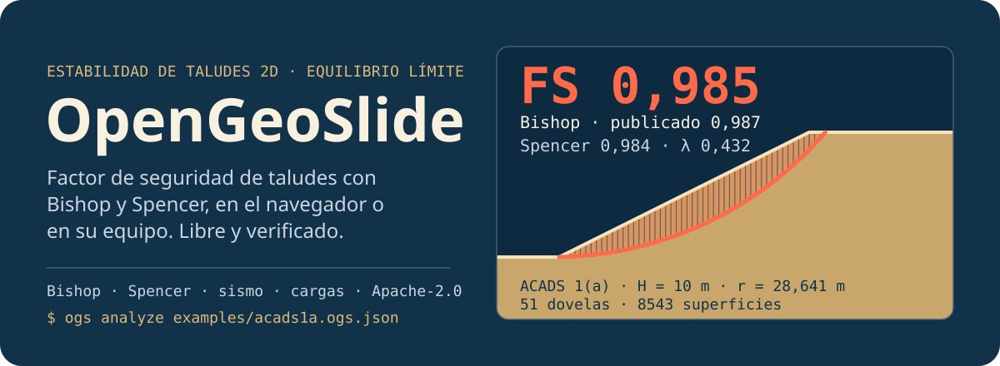
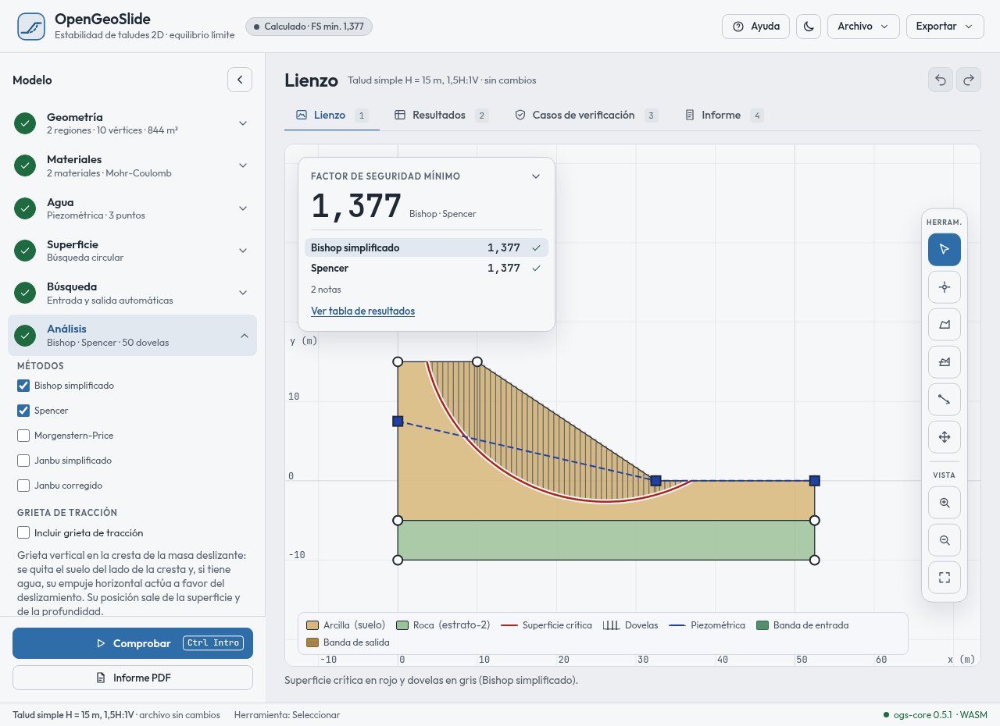
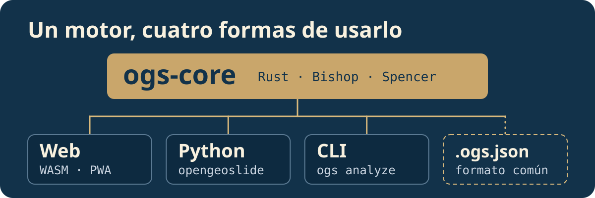

<p align="center">
  
</p>

<p align="center">
  <a href="https://nibaldox.github.io/OpenGeoSlide/"></a>
  <a href="https://github.com/nibaldox/OpenGeoSlide/releases"></a>
  <a href="LICENSE"></a>
  <a href="CITATION.cff"></a>
</p>

<p align="center">
  <picture>
    <source media="(prefers-color-scheme: dark)" srcset="./assets/readme/app-editor-dark.png">
    
  </picture>
</p>

<p align="center"><sub>La aplicación web calculando un talud de dos estratos con piezométrica: Bishop y Spencer dan FS 1,377. Capturas de la versión publicada, en tema claro y oscuro.</sub></p>

## Qué es

OpenGeoSlide calcula el **factor de seguridad (FS) de un talud en 2D** por equilibrio límite, con **Bishop simplificado**,
**Spencer**, **Morgenstern-Price** y **Janbu**. Usted dibuja o importa la sección (estratos Mohr-Coulomb, no drenados,
Hoek-Brown o SHANSEP, línea piezométrica, sismo pseudoestático y cargas), el programa busca la superficie de falla circular
con el menor FS (y, desde el formato v0.6, puede refinarla a una polilínea no circular) o analiza la polilínea que usted fija,
y entrega el FS, las dovelas, los avisos del cálculo y un informe PDF.

Está pensado para ingeniería geotécnica (minería a rajo abierto, botaderos, obras civiles), para docencia y para
investigación. Es software libre (Apache-2.0).

La versión publicada es la **0.5.1**: el motor (Bishop, Spencer, Morgenstern-Price y Janbu simplificado y corregido,
con material no drenado, superficie polilínea fija, sismo pseudoestático y cargas), el formato v0.6 con los materiales
**Hoek-Brown** y **SHANSEP** y la **búsqueda no circular**, el formato v0.5 con **grieta de tracción**, **agua embalsada**
y pilotes de **Ito-Matsui**, el formato v0.4 con **refuerzos** (anclajes, clavos de suelo, geosintéticos, pilotes y
tablestacas, activos y pasivos, con su fuerza en cada cruce con la superficie de falla), la CLI, el editor web (PWA), el
paquete de Python y las pruebas de aceptación.

La 0.5.1 (véase el [registro de cambios](CHANGELOG.md#051---2026-11-27)) **rediseña el editor web** con la identidad
común de la suite: tema oscuro por defecto (con el claro a un clic), los diez pasos del modelo en una barra lateral con
su resumen y su estado, las vistas Lienzo, Resultados, Casos de verificación e Informe, y un recuadro sobre el lienzo con
el FS mínimo y los métodos. El motor, el formato `.ogs.json` y los resultados no cambian: dan la misma salida que la
0.5.0.

Con un pilote o una tablestaca, OpenGeoSlide calcula la estabilidad **global** con el elemento incluido, no su diseño
estructural ([límite](docs/limitaciones.md#pilotes-y-tablestacas-el-límite-estructural-f48)).

La 0.4.0 (véase el [registro de cambios](CHANGELOG.md#040---2026-11-27)) agregó el
formato v0.5 con la **grieta de tracción** (`analysis.tension_crack`: profundidad fija o automática, seca o con agua), el
**agua embalsada** (cuando la línea piezométrica pasa sobre el terreno, el agua libre carga la superficie de falla con
su peso y su empuje, en todas las versiones del formato) y la **fuerza de un pilote por la presión del suelo de
Ito-Matsui** (`lateral_pressure`, con una capacidad de corte y de momento opcional). **Esto cambia el resultado de los modelos con agua sobre el
terreno** respecto de la v0.3.0 ([excepción documentada](docs/limitaciones.md#excepción-a-la-identidad-con-la-v030-agua-sobre-el-terreno)),
y también el de un archivo **imperial** con agua que no indica `water.unit_weight`, que ahora toma γw ≈ 62,45 pcf en lugar de 9,81
([tercera excepción](docs/limitaciones.md#tercera-excepción-a-la-identidad-con-la-v030-γw-por-defecto-en-imperial-e15l-6-e15m-6)).

El formato **v0.6**, publicado con la **0.5.0** (véase el [registro de cambios](CHANGELOG.md#050---2026-11-27)), agrega tres capacidades: el material **Hoek-Brown**
(roca fracturada, con la envolvente completa en bajo confinamiento), el material **SHANSEP** (resistencia no drenada
normalizada por el esfuerzo vertical efectivo, con OCR constante, POP u OCR por cota) y la **búsqueda no circular**
(`analysis.search.non_circular`, sin Bishop). Un modelo sin campos v0.6 da la misma salida, byte a byte, que la 0.4.0. Los
límites están en [Limitaciones conocidas](#limitaciones-conocidas); el formato, en
[`docs/formato-ogs-json.md`](docs/formato-ogs-json.md#hoek-brown-shansep-y-búsqueda-no-circular-v06). La web calcula y
exporta esos modelos (los borradores de material sin aplicar bloquean calcular y exportar, y marcan los FS anteriores como
desactualizados), el wheel de Python los prueba y los documenta, y `ogs bench --method all` omite Bishop con
`non_circular`. Las revisiones adversariales R15 y R16 corrigieron antes de la release el contacto entre materiales con Hoek-Brown o
SHANSEP, y también bajo agua embalsada o con cargas (un defecto que la 0.4.0 tenía entre dos materiales lineales: es
la única excepción deliberada a la identidad con la 0.4.0, y ningún modelo del corpus cambia), el arranque del lazo de
Hoek-Brown y la búsqueda no circular, que no refinaba 14 de 16 taludes homogéneos
([registro de cambios](CHANGELOG.md#050---2026-11-27)).

## Por qué es distinto

- **Está verificado y se puede reproducir.** El motor cumple 347 de 347 checks contra valores publicados (167 casos) y
  coincide con el programa independiente cSlope en 28 de 28 búsquedas, 28 de 28 superficies fijas y 71 de 71 checks de la
  Fase 3a (más 12 de 12 de los refuerzos v0.4 y 58 de 60 del bloque v0.5 de grieta, agua embalsada y pilotes de
  Ito-Matsui, con 2 explicados y ninguna falla abierta). Es la batería real
  de [`verification/`](verification/), no una muestra. Véase [Verificación](#verificación).
- **Un solo motor.** `ogs-core`, escrito en Rust, se compila a WebAssembly para la web, a un wheel de Python y a la CLI
  `ogs`. Las tres leen el mismo formato `.ogs.json`.
- **Funciona sin conexión.** El cálculo corre en el navegador (WASM), no en un servidor; la web se instala como PWA y,
  una vez cargada, no necesita red.
- **Dice lo que no sabe.** Cada resultado trae avisos (`ru` frente a piezométrica, piezométrica
  extrapolada, γsat menor que γ, Spencer sin raíz) y el informe PDF repite las convenciones de signo.

<p align="center">
  
</p>

## Cómo usarlo

### En el navegador (sin instalar)

1. Abra <https://nibaldox.github.io/OpenGeoSlide/>. Se carga el ejemplo ACADS 1(a), un talud homogéneo seco.
2. Pulse **Comprobar**: obtiene Bishop 0,985 y Spencer 0,984, los mismos valores de la cabecera de este README.
3. Cambie la geometría o los materiales en el lienzo y los paneles, o cree un modelo desde cero con
   «Archivo ▸ Talud simple…» y las herramientas «Dibujar región» y «Dividir región».

Desde el navegador puede instalarla como PWA («Instalar aplicación» en Chrome o Edge). El modelo se guarda como
`.ogs.json`; los resultados, como CSV o informe PDF. La web funciona con teclado y en el móvil, y tiene tema claro y
oscuro y unidades SI o imperiales. Para compilarla en local, véase [`docs/desarrollo.md`](docs/desarrollo.md).

### Python

OpenGeoSlide aún **no está en PyPI ni en crates.io**: se instala desde los assets del
[Release v0.5.1](https://github.com/nibaldox/OpenGeoSlide/releases/tag/v0.5.1). El wheel es `abi3` y sirve para
CPython 3.11 o superior; este es el de Linux x86-64:

```sh
WHL=opengeoslide-0.5.1-cp311-abi3-manylinux2014_x86_64.manylinux_2_17_x86_64.whl
pip install "https://github.com/nibaldox/OpenGeoSlide/releases/download/v0.5.1/$WHL"
```

Para macOS (`macosx_11_0_arm64` o `macosx_10_12_x86_64`) y Windows (`win_amd64`), cambie `WHL` por el nombre del `.whl` de
su plataforma, que figura en la página del release. También sirve descargarlo y ejecutar `pip install ./opengeoslide-….whl`.

```python
# desde la raíz del repositorio, donde está examples/
import json, opengeoslide
print(opengeoslide.version())                    # 0.5.1, la versión de ogs-core
report = opengeoslide.analyze(json.load(open("examples/acads1a.ogs.json")))
for r in report["results"]:
    print(r["method"], round(r["fos"], 4), r["status"])
# bishop 0.9851 converged
# spencer 0.9841 converged
```

El paquete (formato v0.6) lee Hoek-Brown, SHANSEP y la búsqueda no circular, además de `analysis.tension_crack` y los
pilotes de Ito-Matsui del formato v0.5, y suma el agua embalsada cuando la piezométrica pasa sobre el terreno, lo que
**cambia el FS** de esos modelos respecto de la v0.3.0. Sus pruebas: 370 pasan y 2 omitidas. Más detalle y ejemplos en [`crates/ogs-py/README.md`](crates/ogs-py/README.md).

### CLI (`ogs`)

Requiere [Rust](https://rustup.rs) (el repositorio fija la versión en `rust-toolchain.toml`):

```sh
git clone https://github.com/nibaldox/OpenGeoSlide.git
cd OpenGeoSlide
cargo install --path crates/ogs-cli --locked     # instala `ogs` en ~/.cargo/bin
ogs --version
ogs analyze examples/acads1a.ogs.json            # informe JSON: FS, círculo crítico y dovelas
```

Sin instalar: `cargo build --release -p ogs-cli` deja el binario en `target/release/ogs`. El formato del modelo (v0.1 a v0.6), con
sismo, cargas, refuerzos, grieta de tracción, Hoek-Brown, SHANSEP y búsqueda no circular, está en [`docs/formato-ogs-json.md`](docs/formato-ogs-json.md).

## Verificación

| Se compara con | Resultado | Informe |
|---|---|---|
| Valores publicados (167 casos) | **347/347** | [REPORT](verification/REPORT.md) |
| cSlope 0.1.0, búsqueda (14 modelos) | **28/28** | [diferencial](verification/differential/REPORT.md) |
| cSlope 0.1.0, superficie fija | **28/28** | [diferencial](verification/differential/REPORT.md) |
| cSlope 0.1.0, M-P, Janbu, no drenado y polilínea (D01-D23) | **71/71** | [diferencial](verification/differential/REPORT.md) |
| cSlope 0.1.0, refuerzos v0.4 (D24-D27) | **12/12** | [diferencial](verification/differential/REPORT.md) |
| cSlope 0.1.0, grieta, agua embalsada y pilotes de Ito-Matsui v0.5 (D28-D42) | **58/60** (2 explicados, 0 fallas) | [diferencial](verification/differential/REPORT.md) |
| cSlope 0.1.0, Hoek-Brown, SHANSEP y búsqueda no circular v0.6 (F3B) | **41/42** (1 explicado, 0 fallas) | [diferencial](verification/differential/REPORT.md) |
| cSlope 0.1.0 como segundo oráculo de los 347 checks | **346/347** | [REPORT](verification/REPORT.md) |
| Web y `ogs` (409 modelos) | **409/409** | [detalle](docs/verificacion.md) |

- **Valores publicados:** 347 checks de 167 casos de la bibliografía (49 en el esquema v0.1, 5 con sismo o cargas en
  v0.2, 53 en v0.3, 23 con refuerzos en v0.4, 21 en v0.5, con 17 de grieta de tracción y 4 de pilotes de Ito-Matsui, y
  16 en v0.6, con HAM1 de Hoek-Brown y 15 de búsqueda no circular),
  cada uno dentro de su tolerancia: 137 de Bishop, 130 de Spencer, 44 de Morgenstern-Price, 11 de Janbu simplificado y
  25 de Janbu corregido. Otros 18
  checks, en 12 casos (3 de ellos de F3B), quedan retenidos con su diagnóstico ([`verification/pending/`](verification/pending/INDEX.md)).
- **cSlope, búsqueda:** Bishop y Spencer en 14 modelos sintéticos, con el mismo método, dovelas y rangos; el FS de ogs no
  supera en más de 1 % al de cSlope.
- **cSlope, superficie fija:** el mismo círculo en los dos programas; el FS difiere en 0,5 % o menos.
- **cSlope, Fase 3a:** Morgenstern-Price y Janbu corregido sobre el círculo fijo de esos 14 modelos, más tres modelos
  nuevos (terraplén sobre arcilla blanda con Su lineal, relaves con Su constante y un bloque sobre una capa débil con
  polilínea fija), con el mismo criterio de 0,5 %.
- **cSlope, v0.5:** los 12 modelos de grieta y agua embalsada (D28 a D39) y los 3 de pilotes de Ito-Matsui (D40 a D42),
  en búsqueda y en superficie fija, con Bishop y Spencer: 58 de 60 checks, con 2 explicados (D39 fija, E15f) y ninguna
  falla abierta.
- **cSlope, v0.6:** 12 modelos de rajo con Hoek-Brown, V047a con SHANSEP y dos casos de búsqueda no circular, en búsqueda y en
  superficie fija: 41 de 42 checks, con 1 explicado (el lazo de Hoek-Brown sin raíz de λ en cSlope, E16t) y ninguna falla;
  F3B-HB-06 con Bishop, que hasta R15 era «explicado» por `m_α`, da 0,5244 frente a 0,5279 de cSlope y pasa a OK. En círculo fijo, el producto da hasta −2,9 % frente a cSlope en Hoek-Brown, siempre del
  lado seguro ([detalle](docs/verificacion.md#hoek-brown-shansep-y-búsqueda-no-circular-v06)).
- **Web y `ogs`:** abrir y guardar un modelo en la web y luego `ogs analyze` da la misma salida, bit a bit.
- **Agua embalsada:** de los 14 casos publicados con la piezométrica sobre el terreno, 8 reciben su peso y su empuje en la
  superficie de sus checks, 1 apenas (V024) y 5 no (V038, V038b, V042, V058 y V061); la tabla medida está en
  [`docs/verificacion.md`](docs/verificacion.md#qué-casos-ejercitan-de-verdad-el-agua-embalsada-e15l-10-r12a-11).

Reproducción y detalle (paridad del editor, rendimiento nativo y WASM) en [`docs/verificacion.md`](docs/verificacion.md).
Esta batería no cubre todo: véanse las limitaciones.

## Limitaciones conocidas

- **La búsqueda es circular, con un refinamiento no circular opcional** (formato v0.6). Es un mínimo local desde 3 círculos,
  con hasta 33 vértices, que cuesta de 2,3 a 3,1 veces la búsqueda circular y que, en materiales con una capa débil, puede
  llevar a una rama con tracción donde el FS de Spencer o Morgenstern-Price queda bajo el publicado (V002: 0,3864 frente a
  0,414; revise las notas `negative_lambda` y `negative_effective_normal_major` y compare con Bishop circular). **Bishop
  simplificado solo admite círculos**: con una polilínea o con la búsqueda no circular quedan Spencer, Morgenstern-Price y
  Janbu ([detalle](docs/limitaciones.md#búsqueda-no-circular-v06)).
- **Cuatro modelos de resistencia:** Mohr-Coulomb, no drenado (Su constante o lineal con la cota), Hoek-Brown y SHANSEP (v0.6).
  **Hoek-Brown** usa la envolvente completa en bajo confinamiento, no la tangente de σ3 = 0 de cSlope: en círculo fijo da hasta
  −2,9 % frente a cSlope, siempre del lado seguro; una búsqueda Bishop tarda unas 12 a 14 veces lo que con Mohr-Coulomb (1,78 s en F3B-HB-01); D no
  tiene valor por defecto, y σci va en kPa, nunca en MPa
  ([detalle](docs/limitaciones.md#hoek-brown-envolvente-completa-costo-y-no-convergencia-v06)). **SHANSEP** es φ = 0 y no
  tiene `aboveWater` (V105a queda retenido); el sismo no entra en σ′v, y con OCR 1 en un perfil normalmente consolidado el
  mínimo es un círculo muy ancho y poco profundo ([detalle](docs/limitaciones.md#shansep-v06)). Ni Hoek-Brown ni SHANSEP se
  combinan con la grieta de profundidad automática ni con los pilotes de Ito-Matsui. Sin análisis de deformaciones, en 3D ni
  de flujo; el agua entra como piezométrica o como `ru`.
- **Refuerzos (formato v0.4): solo estabilidad global.** Con un pilote o una tablestaca, el FS incluye
  su fuerza, que es un dato que usted fija (salvo el pilote de Ito-Matsui de la v0.5, descrito más abajo); **no se
  calcula el empuje sobre el elemento, el empotramiento, el momento
  flector, la deflexión ni las comprobaciones internas o externas de un muro**. **No sirve para diseñar muros de tierra
  mecánicamente estabilizada (TEM) ni otras estructuras de contención.** Se posponen el pretensado como
  campo aparte, la cizalla y la compresión de los clavos, el arrancamiento que depende del material, los clavos
  lanzados, los anclajes helicoidales y la presión de fluido equivalente.
- **Con refuerzos, la búsqueda circular puede esquivar el elemento**, su FS es discontinuo y la búsqueda por defecto
  puede perder el mínimo real (hasta +7,15 % en un caso medido en la revisión R11): compruebe con una malla fina y con
  superficies fijas. Un tirante libre sin placa de cabeza no aplica fuerza (estado `no_capacity`). Un refuerzo activo
  comprimido se aplica con su fuerza completa y **no siempre es conservador**: con φ > 0 su componente normal confina la
  base y puede subir el FS, y el motor lo avisa con una nota; el oráculo instalado de cSlope lo descarta. Un `spacing`
  omitido vale 1 m en SI y 1 ft en imperial. El VP 58 de Slide2 sigue pendiente.
- **Grieta de tracción y agua embalsada (formato v0.5).** La grieta es solo vertical, una por
  superficie, sin zona ni ángulo y sin tope de profundidad por la altura del talud; una superficie que no la alcanza se
  descarta, y una grieta seca puede subir el FS. El agua embalsada no tiene desembalse rápido, el sismo pseudoestático no
  actúa sobre ella ni sobre el agua de la grieta, y su regla con `ru` (`u = ru·(W + V)/b`, la de Slide2) no se puede
  verificar contra el oráculo. El círculo de cSlope de V096a y V086b pasa 8e-7 y 1e-6 bajo el fondo del modelo y el
  motor lo rechaza; sus checks pasan igual, porque la búsqueda de ogs encuentra su propio círculo válido, y lo que queda
  retenido es la fila diferencial D39 fija, marcada «explicado» (E15j-7). **Un modelo con agua sobre el terreno cambia de resultado respecto de la v0.3.0**, a
  propósito: por ejemplo, V047a con 2 m de agua al pie da, en Bishop, 0,848 → 0,939 con superficie fija y 0,132 → 0,924 en búsqueda
  ([detalle](docs/limitaciones.md#grieta-de-tracción-y-agua-embalsada-formato-v05-qué-hace-y-qué-no)).
- **Pilotes de Ito-Matsui (formato v0.5).** La fórmula es para pilotes **rígidos y verticales**, en
  deformación plana, y solo vale con S/D de 2 a 8 (el motor avisa fuera de ese rango; Ukritchon y Keawsawasvong, 2017:
  sobrestima con S/D pequeño y subestima con S/D grande). El piso de φ = 0 no viene del artículo, sino de cSlope y
  XSLOPE, y las cargas de superficie no entran en la sobrecarga del pilote. La `capacity` es un tope, no una
  comprobación del perfil ([detalle](docs/limitaciones.md#pilotes-de-ito-matsui-e15i-qué-hace-y-qué-no)).
- **Una polilínea totalmente sumergida se rechaza** (`no_driving`) en Spencer, Morgenstern-Price y los dos Janbu, del lado
  seguro: cSlope tampoco la resuelve, y el mismo talud con `γ′ = γ − γw` sí converge. El informe puede traer un hueco
  de hasta 1e-6 veces el ancho del modelo entre dos dovelas vecinas. Si falta `water.unit_weight`, el motor usa 9,81 kN/m³ en SI
  y su equivalente (alrededor de 62,45 pcf) en imperial, también en el agua de la grieta
  ([detalle](docs/limitaciones.md#limitaciones-numéricas-conocidas-del-motor)). Medido: una grieta de 2 m con agua y sin
  `water`, en imperial, da Bishop 1,69865, igual que en SI (γw = 62,449 pcf), en lugar de 1,71248. **Es una tercera excepción a la
  identidad con la v0.3.0**: un archivo imperial con agua (también una piezométrica bajo el terreno) y sin `water.unit_weight` cambia de FS,
  y el motor avisa con `water_unit_weight_default`; medido con ACADS 1(a) en pies y una piezométrica bajo el terreno, Bishop da 0,6339
  en lugar de 0,9300 ([detalle](docs/limitaciones.md#tercera-excepción-a-la-identidad-con-la-v030-γw-por-defecto-en-imperial-e15l-6-e15m-6)).
- **El peso unitario saturado (γsat) está verificado solo en cuatro casos** (V082a, V082b, V088 y V089, con la
  piezométrica activa): cumplen sus checks y cSlope los reproduce. Fuera de esos casos no hay otra verificación de γsat,
  y sin línea piezométrica γsat no interviene en el cálculo.
- **La línea piezométrica se prolonga en horizontal hasta los bordes del modelo** si no los cubre, y `ru` tiene
  precedencia sobre ella; con unidades imperiales, γw debe ser explícito.
- **Sismo solo pseudoestático y cargas solo uniformes o lineales.** Spencer y Morgenstern-Price pueden no hallar
  solución o, con tracción en la base, quedar por debajo de Bishop. En polilíneas con forma de V pueden converger con un
  FS no físico (aviso `interslice_shear_exceeds_strength`): compárelo con Janbu. Revise siempre los avisos.
- **Casos publicados retenidos:** V027, V028, V068, V035b y V083 (aviso de normal efectiva negativa), V032a (la búsqueda halla un
  mínimo real, más conservador), V009a y V009b (aviso de cortante entre dovelas) y V085 ×4 (la búsqueda de ogs halla un
  círculo más crítico que el del oráculo); de F3B, V002 (rama de tracción de la búsqueda no circular, E16u), V009c (aviso de
  cortante entre dovelas) y V105a (SHANSEP con `aboveWater`, fuera del formato): 18 checks en 12 casos en total.

El detalle completo, con los avisos y los casos numéricos conocidos del motor, está en
[`docs/limitaciones.md`](docs/limitaciones.md).

## Contribuir, citar y licencia

- **Contribuir:** [`CONTRIBUTING.md`](CONTRIBUTING.md) describe el entorno y el flujo de verificación de un PR. La guía
  para compilar y probar está en [`docs/desarrollo.md`](docs/desarrollo.md). Los problemas de seguridad, según
  [`SECURITY.md`](SECURITY.md).
- **Citar:** [`CITATION.cff`](CITATION.cff) (GitHub ofrece «Cite this repository»). Registro de cambios en
  [`CHANGELOG.md`](CHANGELOG.md).
- **Licencia:** Apache-2.0, véase [LICENSE](LICENSE). Los datos de verificación adaptados de cSlope conservan su
  licencia MIT ([NOTICE](NOTICE)).

> **Aviso.** OpenGeoSlide es software en desarrollo y no es una herramienta certificada. Los resultados deben
> validarse por un profesional competente antes de usarlos en un diseño. El criterio profesional y la
> responsabilidad sobre el diseño son del usuario.

## In English

OpenGeoSlide is free software (Apache-2.0) for 2D limit-equilibrium slope stability (simplified Bishop, Spencer,
Morgenstern-Price and Janbu; circular search with an optional non-circular refinement, plus fixed polyline surfaces; Mohr-Coulomb, undrained, Hoek-Brown and SHANSEP strength;
pseudo-static seismic loads and surface loads; reinforcements in the v0.4 format: anchors, soil nails,
geosynthetics, piles and sheet piles; the v0.5 format adds the tension crack and ponded water, which changes
the result of models with water above the ground compared with v0.3.0 (as does an imperial model with water and no `water.unit_weight`, which now takes γw of 62.45 pcf instead of 9.81), and the soil-pressure force of a pile after Ito and Matsui, rigid vertical piles only, S/D 2 to 8). One Rust engine powers a web app that
runs in your browser and works offline, a Python package and a CLI. It matches 347/347 published values (167 cases) and cSlope in
28/28 searches, 28/28 fixed surfaces, 71/71 Phase 3a checks, 12/12 reinforcement checks, 58/60 tension-crack, ponded-water and Ito-Matsui pile checks (2 explained, no open failures) and 41/42 checks of the v0.6 format (Hoek-Brown, SHANSEP and the non-circular search; 1 explained, no open failures). The v0.6 format, released with 0.5.0, adds the Hoek-Brown material (full envelope at low confinement, not cSlope's tangent: up to 2.9 % lower in fixed-circle runs, always on the safe side), the SHANSEP material and a non-circular refinement of the search (no Bishop; a local minimum that can fall below the published value in weak-layer models with tension, as V002 does). With a pile or sheet pile that carries a given force it checks the
global stability with that force included and does not compute the earth pressure on the element; the Ito-Matsui pile of
the v0.5 format only estimates the soil force between rigid vertical piles (S/D 2 to 8). Neither computes embedment,
bending moment, deflection or the internal and external checks of a wall, so OpenGeoSlide is not a tool for designing
piles, MSE walls or retaining structures. Try it at <https://nibaldox.github.io/OpenGeoSlide/>, get the wheel
from the [Releases](https://github.com/nibaldox/OpenGeoSlide/releases), and cite it with [`CITATION.cff`](CITATION.cff).
It is not a certified tool: a qualified professional must validate every result.
